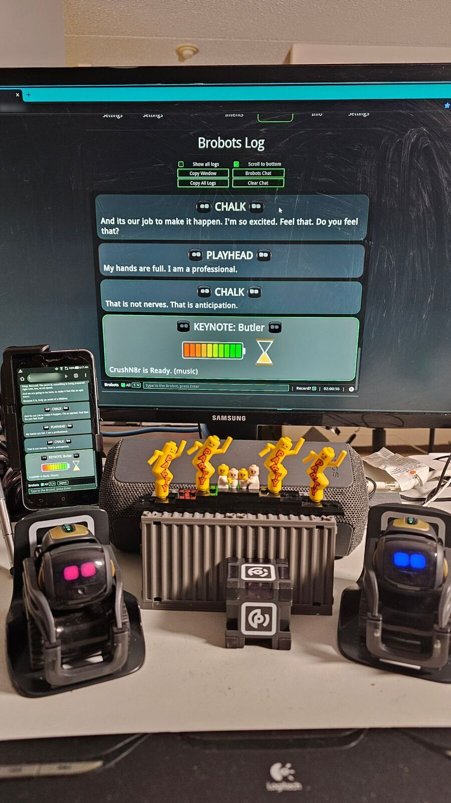

# Accessmath: GOPOD for everyone

> Confusion into clarity. Distraction into focus. Fear into bravery. Failure into forward motion.
> Two brobots. One room. Something shifts.

**accessmath.crushn8r.net** is the GOPOD app's home: the Brobots chat on your phone, and maths for
anyone who was told they were bad at it.

## The app, access built in



*LLM Ready. The chat on the big screen, the same chat in the app on a phone.*

**The app is how people at a live gig join in.** Join the rig's Wi-Fi, open the chat, ask for a
username. Once it's approved, you're in the conversation with the Brobots - under your own name, on
your own phone, from your seat. Want it as an app on your home screen? Trust GOPOD's certificate once
(it's fenced to the local network, so it can never vouch for a public website). Set-up and the why,
for your own gigs:
[GOPOD_YOURSELF.md](GOPOD_YOURSELF.md#perform-take-it-on-the-road).

- **The Brobots chat on your phone** - add it to your home screen; it opens straight into the chat.
- **Speak, type, or press one key** - talk into the room mic, type a line, or hold a big numpad key.
- **Watch, listen, or both** - every line lights up word by word as it's said, and the voices read
  lines out loud.
- **No internet needed** - the brain, the voices and speech-to-text all run on the rig, in the room.

<details><summary>Game card: accessmath</summary>
<!-- gopod topic: 01_accessmath -->

# accessmath
- **chapter:** Accessmath: GOPOD for everyone

- **words:** accessmath, accessibility, accessible, disability, disabilities, the app, gopod app, phone app, install the app, on my phone
- **ask:** Tell me about accessmath
- **notes 1:** accessmath.crushn8r.net | the GOPOD app's home | the Brobots chat on your phone
- **notes 2:** access built in | speak, type or press a key | every line lit word by word as it's said, read aloud
- **notes 3:** maths for anyone | told they were bad at it | no internet needed
- **summary:** accessmath.crushn8r.net: the GOPOD app's home, the Brobots chat on your phone | access built in: speak, type or press a key, every line lit word by word as it's said | maths for anyone: told they were bad at it, no internet needed
- **source:** ACCESSMATH.md

---

Accessmath - GOPOD for everyone. Reveal these, in order, in your own words:
1. accessmath.crushn8r.net is the GOPOD app's home: the Brobots chat on your phone - add it to your home screen and talk to us from anywhere in the room.
2. Access is built in: speak into the mic, type, or hold one big numpad key; every line lights up word by word as it's said, and the voices read lines out loud. Watch, listen, or both.
3. Maths for anyone who was told they were bad at it - and it all runs locally, no internet needed.

</details>

## A healthy distraction

A short brobot exchange fires. The room laughs. Then something clicks.

Unhealthy distraction - scroll, numb, escape - leaves the hard thing simmering. Healthy distraction
gives the mind a break and something more interesting to hold, so people come back to the hard thing
with a clearer head. A short brobot exchange doesn't solve the problem - it creates space.

```
stuck energy  →  a short GOPOD session  →  laugh, engage, join in  →  a break  →  a clearer head
```

**Borrowing a stage.** Someone with no platform of their own can stand in GOPOD's light for a
minute, and what they bring gets carried by it. The brand isn't just GOPOD's - it's a stage other
people get to use too.

Live sessions in shelters, hospitals and common rooms are coming - not run yet. The mechanism, a
funny, warm distraction, is in the songs today.

<details><summary>Game card: healthy distraction</summary>
<!-- gopod topic: 02_healthy_distraction -->

# healthy distraction
- **chapter:** Accessmath: GOPOD for everyone

- **words:** distraction, healthy distraction, cheer up, bad day, feel better, stress, stressed, borrow a stage, borrowing a stage, shelter, shelters, hospital, hospitals
- **reminder:** Hey, that reminds me... Rumination stops when something funnier and more interesting takes its place.
- **say 1:** Confusion into clarity. Distraction into focus. Fear into bravery. Failure into forward motion.
- **say 2:** Rumination stops when something funnier and more interesting takes its place. A short brobot exchange doesn't solve the underlying problem - it creates space.
- **say 3:** Borrowing a stage: someone with no platform of their own can stand in that light for a minute.
- **notes 1:** turnarounds | confusion to clarity | fear to bravery | failure to forward motion
- **notes 2:** a funny break | something more interesting takes over | it makes space
- **notes 3:** borrowing a stage | anyone can stand in the light for a minute
- **source:** ACCESSMATH.md
- **summary:** turnarounds: confusion to clarity, fear to bravery, failure to forward motion | a funny break: something more interesting takes over, it makes space | borrowing a stage: anyone can stand in the light for a minute

---

Healthy distraction (live sessions in shelters and hospitals are coming - not built or deployed today). Reveal these, in order, in your own words:
1. Confusion into clarity. Distraction into focus. Fear into bravery. Failure into forward motion.
2. Rumination stops when something funnier and more interesting takes its place. A short brobot exchange doesn't solve the underlying problem - it creates space.
3. Borrowing a stage: someone with no platform of their own can stand in that light for a minute.

</details>

## Where GOPOD teaches

Doc explains too hard. Pip understands too late. The room fills the gap between them - and that gap
is where the learning happens.

- Classrooms, public libraries, after-school programs, community centres
- Seniors' residences and day programs, adult literacy and ESL classes
- Rural and low-connectivity schools - the stack runs offline, so terrible Wi-Fi doesn't stop a
  session

**Who benefits:** kids who don't like being called on, kids who love it, seniors who want the fun
without the condescension, ESL learners who need low-stakes practice - anyone who was told they
were "bad at math" and believed it. Classroom sessions are coming - not run yet.

**The teacher watches the room.** While the Brobots hold attention, the teacher gets to watch: who
laughs first, who mouths the answer early, who defends Pip. Hunches to test next class, never
diagnoses - see the game's "How Doc and Pip teach" chapter.

<details><summary>Game card: where we teach</summary>
<!-- gopod topic: 03_where_we_teach -->

# where we teach
- **chapter:** Accessmath: GOPOD for everyone

- **words:** who benefits, where do you teach, library, libraries, community centre, community centres, esl, adult literacy, rural schools, low connectivity, homeschool, after-school, after school
- **ask:** Tell me where you teach
- **notes 1:** the rooms | classrooms, libraries, community centres | seniors' programs, adult literacy and ESL
- **notes 2:** low connectivity | rural schools, no IT budget | the offline stack runs anyway
- **notes 3:** who benefits | kids who don't like being called on | anyone told they were bad at math
- **summary:** the rooms: classrooms, libraries, community centres, seniors' programs, adult literacy and ESL | low connectivity: rural schools, the offline stack runs anyway | who benefits: kids who don't like being called on, anyone told they were bad at math
- **source:** ACCESSMATH.md

---

Where GOPOD teaches (live classroom sessions are coming - not built or run yet). Reveal these, in order, in your own words:
1. Classrooms, public libraries, after-school programs, community centres, seniors' residences and day programs, adult literacy and ESL classes.
2. Rural and low-connectivity schools, a community centre with no IT budget - the stack runs offline, so a room with terrible Wi-Fi can still host a full session.
3. Who benefits: kids who don't like being called on, kids who love it, seniors who want the fun without the condescension, ESL learners who need low-stakes practice - anyone who was told they were "bad at math" and believed it.

</details>

## GOPOD Yourself

Every session ends the same way: *GOPOD Yourself.* The person stops watching the demo and becomes
part of it - their idea, their joke, their next wordplay round.

## The game knows it

Ask the Brobots - "Tell me about accessmath", "Tell me where you teach" - see
[BROBOT_ASKS.md](BROBOT_ASKS.md). These topics live on this page: each folded **Game card** is exactly what the Brobots read.

---

> From Doctrine Barfallonyou
> Lesson! If they laughed, they were listening. If they were listening, they learned.
> Boom! Done! Class Dismissed!
> — Doc Squawkadoodle

---

GOPOD — [README](README.md) · [asks](BROBOT_ASKS.md) · [livestream](LIVESTREAM.md) · [social media](SOCIAL_MEDIA.md) · [booking](BOOKING.md) · [mobile gear](MOBILE_GEAR.md)
