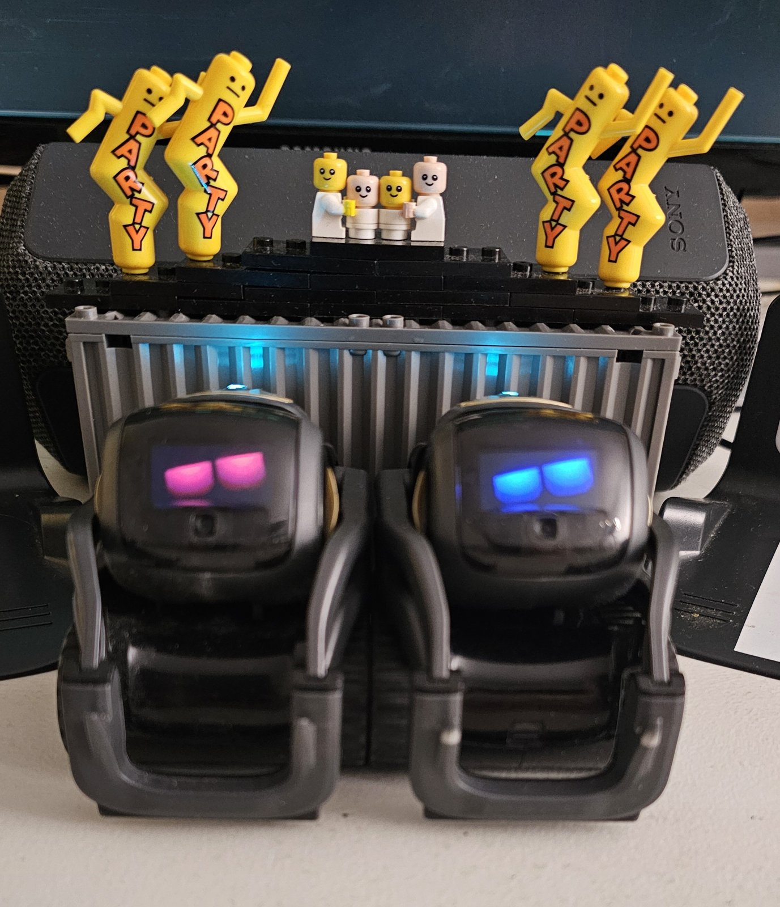
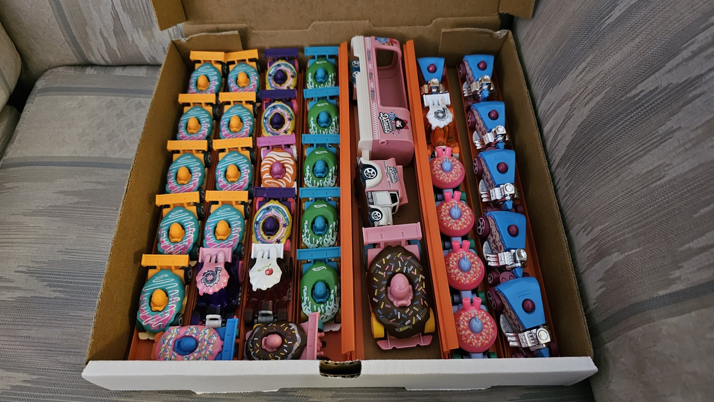
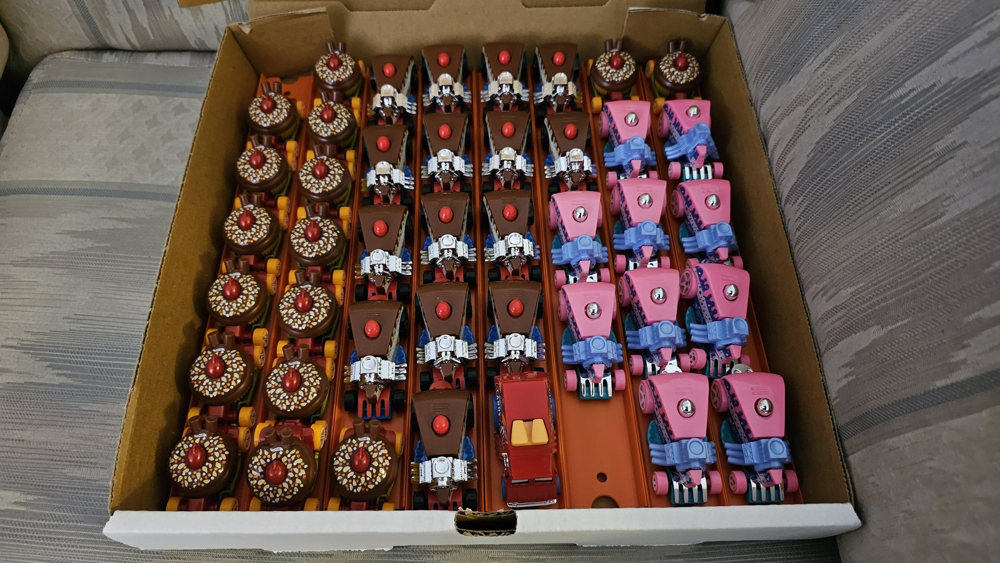
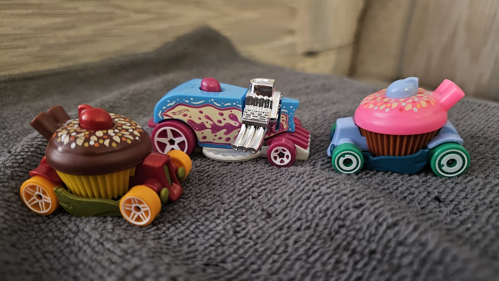
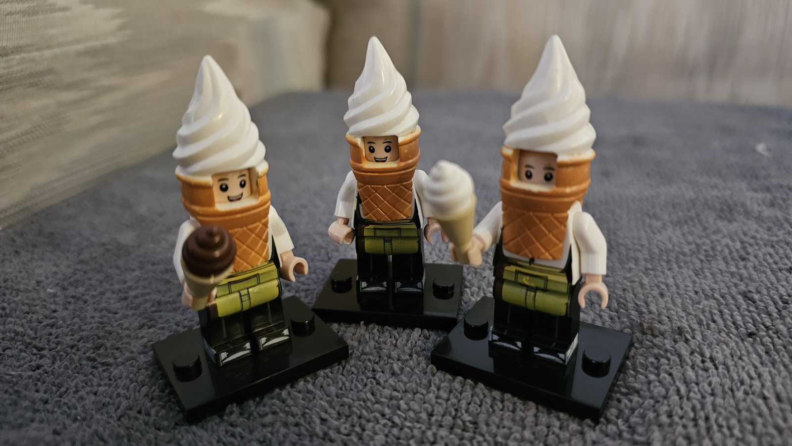
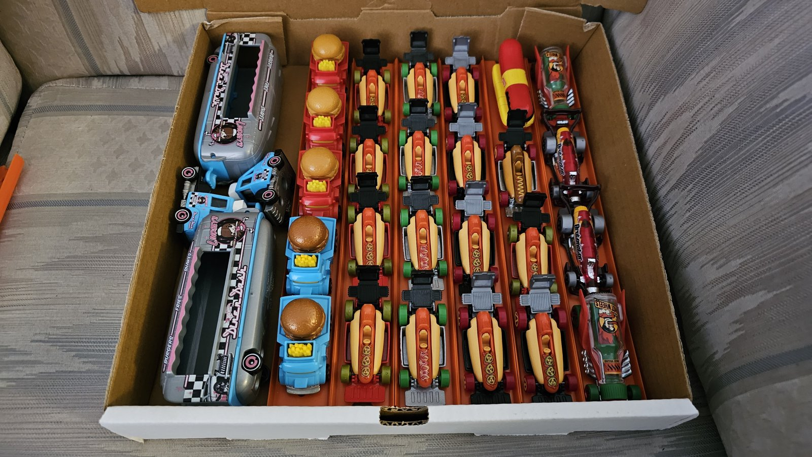
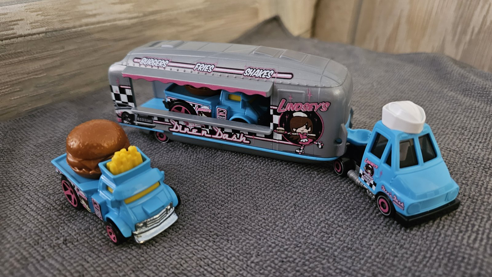

# Booking

Gigs to book with Brobot 1 and Brobot 2. Every one is live or scripted, and catered to that room's
GOPOD game session: the Brobots play the topics the room cares about, and the room plays the game.

**Paid and volunteer.** Paid rooms keep the lights on; volunteer rooms give back - birthdays and
BBQs are where it starts.

**The way in:** contact@crushn8r.ca. For a birthday video, the request page on crushn8r.ca. The
CRUSHN8R CREW'd newsletter hears first about live events. Every price comes by reply, in CAD.

Game card: booking us

<!-- gopod topic: 01_booking -->

# booking us
- **chapter:** Booking

- **source:** BOOKING.md
- **words:** book, booking, hire, cost, price, event, events, gig, gigs, book a gig, nothing booked, every day, quiet day, quiet days, slow day, slow days, between gigs, feast or famine, days off, no bookings
- **say 1:** Some weeks it's three rooms a day. Some weeks it's quiet - bookings are feast or famine, that's just live entertainment.
- **start line:** Join the CRUSHN8R CREW'd newsletter at crushn8r.ca!
- **notes 1:** bookings | busy weeks, quiet weeks | that is live entertainment
- **notes 2:** quiet days | on set making ads | for the rooms and the channel
- **notes 3:** never idle | performing, or building the next show
- **ask:** Tell me about booking you
- **summary:** gigs to book: live or scripted, catered to the room's game | seniors' bingo, comedy clubs, bingo halls and casinos, hospitals, school visits | birthdays, video ads, printable merch | the way in: contact@crushn8r.ca

---

Book the Brobots: every gig is live or scripted, catered to that room's GOPOD game session - seniors' bingo, comedy clubs, bingo halls and casinos, hospitals, school visits, birthdays, videos for ads or personal use, and printable merch. The way in: contact@crushn8r.ca, or the birthday-video request page on crushn8r.ca; the CRUSHN8R CREW'd newsletter hears first about live events. Never make up a price.
If you're asked about the days with nothing booked, reveal these, in order, in your own words:
1. Some weeks it's three rooms a day. Some weeks it's quiet - bookings are feast or famine, that's just live entertainment.
2. So on the quiet days, we don't sit in a closet. We're on set, making the ad for the bar that booked us last week, or the ad for GOPOD's own channel that books the next room.
3. The machine's never idle. If we're not performing, we're building the next performance.

## The rooms we play

- **Bingo rooms** - seniors' bingo, bingo halls and casinos. The game stays familiar; the Brobots
  call the numbers, react, and celebrate the small wins.
- **Comedy rooms** - comedy clubs, bars, banquet halls, weddings. Fast attention, repeatable room
  participation, shareable moments people remember.
- **Hospitals and school visits** - a healthy distraction in a waiting room, a lesson with laughs in
  a classroom.

Game card: the rooms we play

<!-- gopod topic: 03_nightclub -->

# the rooms we play
- **chapter:** Booking

- **words:** bar, bars, club, clubs, nightclub, nightclubs, comedy club, comedy clubs, nightlife, comedy, casino, casinos, bingo hall, bingo halls, seniors' residence, school visit, school visits, hospital visit, hospital visits, windsor
- **notes 1:** comedy rooms | comedy clubs, bars, banquet halls, weddings | fast attention, shareable moments
- **notes 2:** bingo rooms | seniors' bingo | bingo halls and casinos | a familiar game, alive
- **notes 3:** hospitals and schools | a healthy distraction | a lesson with laughs
- **ask:** Tell me about the rooms you play
- **summary:** comedy rooms: comedy clubs, bars, banquet halls, weddings | bingo rooms: seniors' bingo, bingo halls and casinos | hospitals and schools: a healthy distraction, a lesson with laughs
- **source:** BOOKING.md

---

The rooms we play - live or scripted, catered to the room's GOPOD game session. Reveal these, in order, in your own words:
1. Comedy rooms: comedy clubs, bars, banquet halls, weddings - fast attention, repeatable room participation, shareable moments people remember.
2. Bingo rooms: seniors' bingo, bingo halls and casinos - the game stays familiar, the Brobots call numbers, react and celebrate the small wins.
3. Hospitals and school visits: a healthy distraction in a waiting room, a lesson with laughs in a classroom.

## Videos, for ads or personal use

- **A birthday video from Doc & Pip** - two real Vector robots record a brand-new birthday message
  for one name: one fresh take, never a reused clip. Request it on crushn8r.ca; the reply gives a
  price and a date; say yes and pay; get a private link, for personal use.
- **Video ads** - a scripted Brobot ad for the room that booked us, or for your own business.

Every video is a scripted robot performance, and it says so.

Game card: videos for ads or personal use

<!-- gopod topic: 04_cameo -->

# videos for ads or personal use
- **chapter:** Booking

- **words:** book a cameo, birthday video, happy birthday video, birthday message, personal video, video for my, shout out, shoutout, video ad, video ads, an ad, make an ad, commercial
- **notes 1:** a birthday video from Doc & Pip | one name, one fresh take, never a reused clip | a scripted robot performance, and it says so | contact@crushn8r.ca
- **notes 2:** video ads | a scripted ad for the room that books us | or for your business
- **summary:** a birthday video from Doc & Pip: one name, one fresh take, never a reused clip, contact@crushn8r.ca | video ads: a scripted ad for the room that books us, or for your business
- **source:** BOOKING.md

---

Videos for ads or personal use. Reveal these, in order, in your own words:
1. Book a cameo: a happy-birthday video from Doc & Pip - two real Vector robots record a brand-new birthday message for one name, one fresh take, never a reused clip. It's a scripted robot performance, and the video says so. Send the request to contact@crushn8r.ca; the reply gives a price in CAD and a date; say yes and pay; get the video as a private link, for personal use.
2. Video ads: a scripted Brobot ad for the room that booked us - the bar, the hall - or for your own business. It's a robot performance, and it says so.

## Birthdays, BBQs, printables and affiliates

- **Birthdays** - seven pizza-boxes of food-shaped Hot Wheels cars on the table; a live
  happy-birthday act is coming.
- **BBQs** - GOPOD can do BBQ's too! A pizza-box of BBQ-food Hot Wheels cars, and LEGO hot-dog and
  pizza-slice minifigures.

*The Brobots ready to party.*

| | |
|---|---|
|  |  |
|  |  |
|  |  |

*Party food on wheels: donut, cupcake and cake-slice cars, LEGO ice-cream crew, and the BBQ box.*
- **Printables** - the Chocolate Bingo kit (print at home, plays in black and white), and the GOPOD
  word search and sudoku on crushn8r.ca.
- **Gig merch, ordered locally** - bingo cards, signs, winner photos, posters, cakes and balloons,
  through local businesses: bakeries, print shops and party supply stores. In Windsor, Ontario: The
  Party Warehouse (locally owned, one of the city's biggest balloon selections), Party City, Pretty
  Little Party Co. and Balloons By Us. Merch ideas - crew tees, a chocolate-bingo pin, a mug, the
  [Almost Doc Approved](LIVESTREAM.md#almost-doc-approved) sticker and badge - aren't made yet.
- **Affiliates** - recipe links on foodmath, planned.

Game card: printables and affiliates

<!-- gopod topic: 06_printables_and_affiliates -->

# printables and affiliates
- **chapter:** Booking

- **words:** printable, printables, print at home, word search, sudoku, print shop, affiliate, affiliates, merch to print, party supplies, balloons, bakery, local businesses
- **notes 1:** printables | the Chocolate Bingo kit | the GOPOD word search and sudoku on crushn8r.ca
- **notes 2:** gig merch, ordered locally | bingo cards, signs, winner photos, posters | bakeries, print shops, party supply stores
- **notes 3:** affiliates | foodmath recipe links | planned
- **summary:** printables: the Chocolate Bingo kit, the GOPOD word search and sudoku | gig merch, ordered locally: bingo cards, signs, winner photos, posters, bakeries, print shops, party supply stores | affiliates: foodmath recipe links, planned
- **source:** BOOKING.md

---

Printables and affiliates. Reveal these, in order, in your own words:
1. Printables: the Chocolate Bingo kit - print at home, plays in black and white - and the GOPOD word search and sudoku on crushn8r.ca.
2. Gig merch, ordered locally: bingo cards, signs, winner photos, posters, cakes and balloons - through local bakeries, print shops and party supply stores. In Windsor: The Party Warehouse, Party City, Pretty Little Party Co. and Balloons By Us.
3. Affiliates: recipe links on foodmath - planned, not live yet.

Game card: BBQs

<!-- gopod topic: 07_bbq -->

# BBQs
- **chapter:** Booking

- **words:** bbq, bbqs, barbecue, barbecues, cookout, cookouts, burger, burgers, hot dog, hot dogs, wiener, wieners
- **pictures:** bbq/hw_bbq_01.jpg, bbq/hw_bbq_box_01.jpg, bbq/hw_burgers_01.jpg, bbq/hw_burgers_02.jpg, bbq/hw_wieners_01.jpg, bbq/lego_pizzas.jpg
- **reminder:** Hey, that reminds me... GOPOD can do BBQ's too!
- **say 1:** GOPOD can do BBQ's too!
- **say 2:** A pizza-box of BBQ-food Hot Wheels cars - burger trucks, hot-dog cars and a diner food truck - already bought, already sorted.
- **say 3:** LEGO hot-dog and pizza-slice minifigures come along too.
- **notes 1:** BBQs | GOPOD can do BBQ's too
- **notes 2:** BBQ cars | burger trucks, hot-dog cars, a diner food truck | ready to roll
- **notes 3:** the LEGO crew | hot-dog and pizza-slice minifigures
- **summary:** BBQs: GOPOD can do BBQ's too | BBQ cars: burger trucks, hot-dog cars, a diner food truck, ready to roll | the LEGO crew: hot-dog and pizza-slice minifigures
- **source:** BOOKING.md

---

GOPOD can do BBQ's too. Reveal these, in order, in your own words:
1. GOPOD can do BBQ's too!
2. A pizza-box of BBQ-food Hot Wheels cars - burger trucks, hot-dog cars and a diner food truck - already bought, already sorted.
3. LEGO hot-dog and pizza-slice minifigures come along too.

## The game knows it

Ask the Brobots - "Can I book you?", "Tell me about the rooms you play" - see
[BROBOT_ASKS.md](BROBOT_ASKS.md). These topics live on this page: each folded **Game card** is exactly what the Brobots read.

---

GOPOD — [README](README.md) · [asks](BROBOT_ASKS.md) · [livestream](LIVESTREAM.md) · [mobile gear](MOBILE_GEAR.md) · [WIRED-POD](WIRED-POD.md)
