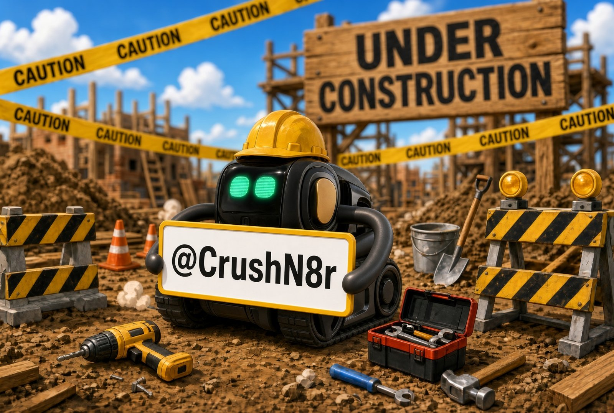
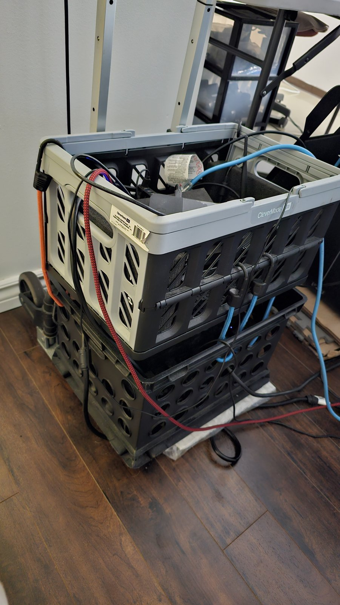
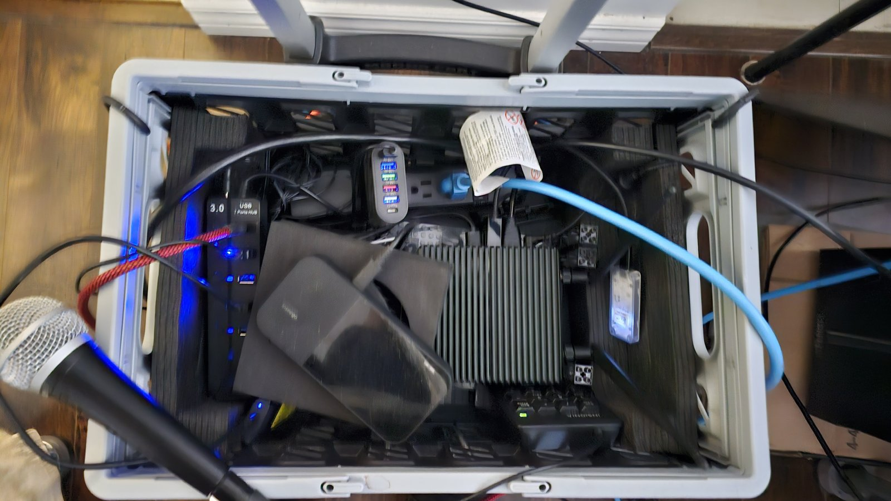

# GOPOD

Now that you're here, you can GOPOD Yourself! Lol

Two rescued Vector robots, Brobot 1 and Brobot 2, running on Wire-Pod and talking out loud
with a local AI. No cloud.

> AI Wordplay! Explain the Math!

Wire-Pod is the open-source local server that keeps Anki Vector robots running without the
original cloud. GOPOD runs two of them, Brobot 1 and Brobot 2, on one Jetson: one shared
conversation, scripted performances, and upstream Wire-Pod left untouched through an overlay
build.

**Watch:** [VIDEO PLACEHOLDER — `start bingo test` run]

## What it does

- **Two Brobots, one conversation.** Ask either Vector. They share one chat, remember it, and
  each knows which brother he is.
- **A local brain.** Ollama with `gemma2:2b` on a Jetson, loaded at start and kept warm. No
  cloud, no monthly bill.
- **A chat window on Wire-Pod's own page.** Each line lights up as it's spoken. Type a line,
  or hold a numpad key and talk.
- **Named runs.** `start interview` plays a scripted interview, the same every
  time and ready to record. `start bingo test` plays the Bingo test song. `start baby
  brobots` plays a lyric video in the chat while the Brobots act it out. `start fart joke`
  plays the fart joke. `stop run` stops any of them at a safe spot.
- **GOPOD Yourself.** Say the wake phrase: Brobot 1 points you to the newsletter, Brobot 2 to
  crushn8r.ca.
- **Generate, then script.** The local LLM writes the interview, you keep the best takes,
  and the result is a plain script you can edit and replay.
- **Native Wire-Pod stays stock.** GOPOD changes nine Wire-Pod files through Go's overlay
  build and keeps everything else in its own folder.

## What's new

- **System menu.** Click the speaker icon on the chat page: every setting, song, voice and
  test, grouped in order, answered in the same window. Edit GOPOD without a terminal.
- **Camera feeds.** Each Brobot's camera in the chat, with the Edge TPU's object boxes.
  KP+ / KP- switch feeds.
- **The app.** Visitors open the chat on their phone as an app: the Brobots chat alone, the
  same bubbles and highlight, nothing of Wire-Pod's own pages.
- **A cast on the numpad.** KP1/KP2 talk to the Brobots, KP0 to both. KP7 CHALK and KP8
  PLAYHEAD (the news crew), KP3/KP4 the Cozmo students Git Repo and Cache PYC, KP5/KP6 the
  Moorebot Scout security guards Intel 404 PNFH and PNFT, KP9 Cameo (social media): each a
  voice persona with its own Kokoro voice (the guards one voice, pitched apart with sox),
  answering from the local LLM. Pick each key's voice from a menu (`system-voices`).
- **Before and after a song.** Ask about Bingo or dreams before the song has played and the
  Brobots tease it; after, they remember it their own way, and one of them tells the viewers
  how to start it. One template for every song (`experiences` in the settings file).
- **Voice files that look after themselves.** Each voice file carries a profile: made when,
  played how often, last played. `system-voices-report week` shows what's popular.
- **Your files stay yours.** Wire-Pod runs as root; everything GOPOD makes in your home (voices,
  photos, sessions) is still owned by you.

## Take it home

[WIRED-POD.md](WIRED-POD.md) is the Take Out: a thank-you back to the Wire-Pod community in
three parts. Part 1 is the alias play studio, part 2 the chat page, part 3 the offline LLM.
Each part lists what you need, what to copy, what to change, and how to know it works. How songs are built, note by
note, is in [ALIAS-PLAY-STUDIO.md](ALIAS-PLAY-STUDIO.md).

**GOPOD not tested on other devices or set ups. Back up your stuff and attempt at your own risk.**

## The rig

Two crates on one dolly. Roll in, plug in, party.

| Part | What it does |
|---|---|
| 2 × Anki Vector | Brobot 1 and Brobot 2. |
| NVIDIA Jetson Orin NX 16GB (Ubuntu) | Runs Wire-Pod, Ollama, the voices and the chat page. |
| Anker Solix C1000 | Portable power station (the bottom crate). |
| Inseego MiFi M3000 hotspot | Local Wi-Fi linking the two robots and the Jetson. |
| XLR mic and an XLR-to-USB cable | The room mic: numpad push-to-talk and Record Session. |
| USB numpad, USB 3.0 hub, power bar, fan | Push-to-talk keys, ports, power, cooling. |
| Coral USB Edge TPU | The object boxes on the Brobots' camera feeds. |

The crates, power and networking modes, with more photos: [MOBILE_GEAR.md](MOBILE_GEAR.md).

About $1K to $3K CDN.

## Privacy and safety

- **Local first.** The LLM, speech-to-text and the voices all run on the Jetson. Only the
  live weather goes online (Wire-Pod's own weather key); offline, the Brobots say so.
- **Nothing private in this repo.** No API keys, robot tokens or certificates, and no
  conversation logs or recordings. Those stay on the machine.
- **A clean act.** The room is adult, the material isn't: no drinking, no swearing, and
  gambling never comes up.

## Where it stands

Live-tested: the Brobots chat, the scripted interview, the Bingo test song, numpad
push-to-talk, the numpad's voice personas. Not yet, and said plainly: see "Where this stands" in
[WIRED-POD.md](WIRED-POD.md#where-this-stands). The websites are under construction; some
work well enough to demo.

## More

- [BROBOT_ASKS.md](BROBOT_ASKS.md): what to ask the Brobots - each topic's ask, what you get,
  and where to read more.
- [MOBILE_GEAR.md](MOBILE_GEAR.md): the rig on its dolly - what's in each crate, the
  networking and power modes, and the photos.
- [BOOKING.md](BOOKING.md): gigs to book - the rooms, birthdays, BBQs, videos, printables and
  affiliates, live or scripted.
- [ACCESSMATH.md](ACCESSMATH.md): GOPOD for everyone - the app, access built in, a healthy
  distraction, and where GOPOD teaches.
- [SOCIAL_MEDIA.md](SOCIAL_MEDIA.md): the socials, the niche pillars, and help wanted.
- [LIVESTREAM.md](LIVESTREAM.md): the livestream - AI Wordplay! Explain the MAth!, the contest
  and its nine themes, where it lands, and the channel.
- **Contact:** [crushn8r.ca](https://crushn8r.ca), and the CRUSHN8R CREW'd newsletter.

## Credits

Built on [Wire-Pod](https://github.com/kercre123/wire-pod) by kercre123 and its contributors,
the community that kept Vector alive. MIT license, see [LICENSE](LICENSE). Third-party
licenses: [THIRD_PARTY_LICENSES.md](THIRD_PARTY_LICENSES.md).
