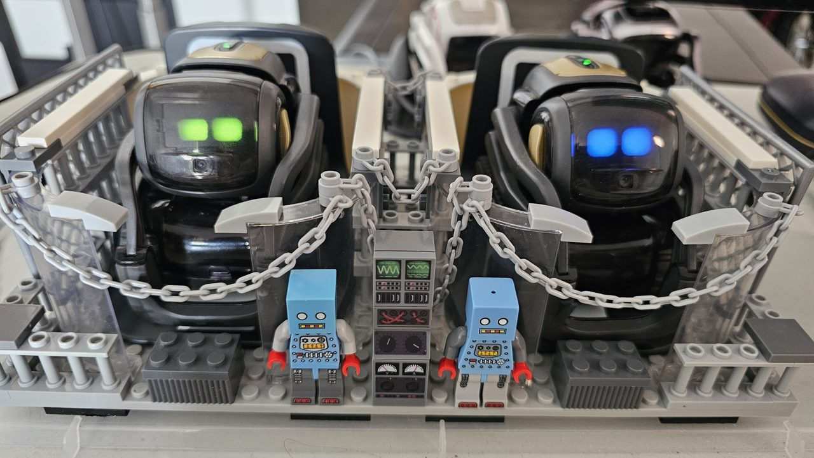
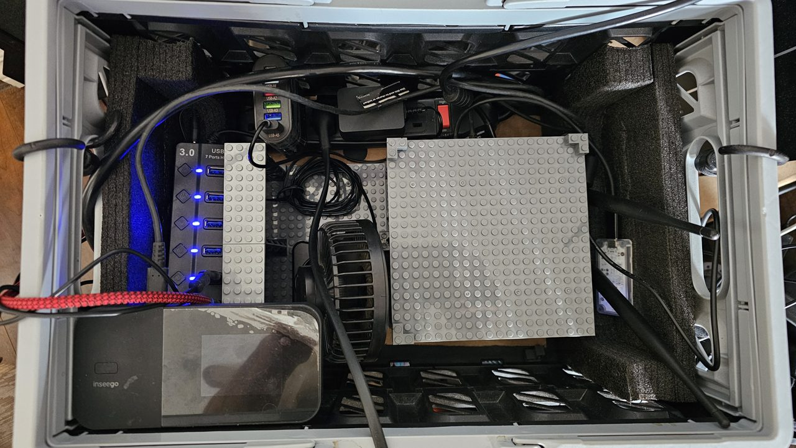

# GOPOD

Two rescued Vector robots, Brobot 1 and Brobot 2, running on Wire-Pod and talking out loud
with a local AI. No cloud.

> AI Wordplay! Explain the Math!

**Watch:** [VIDEO PLACEHOLDER — one recorded `start interview` run]

## What it does

- **Two Brobots, one conversation.** Ask either Vector. They share one chat, remember it, and
  each knows which brother he is.
- **A local brain.** Ollama with `gemma2:2b` on a Jetson, loaded at start and kept warm. No
  cloud, no monthly bill.
- **A chat window on Wire-Pod's own page.** Each line lights up as it's spoken. Type a line,
  or hold a numpad key and talk.
- **Named runs.** `start interview` plays a scripted ten-question interview, the same every
  time and ready to record. `start bingo test` plays the Bingo test song. `start baby
  brobots` plays a lyric video in the chat while the Brobots act it out. `stop run` stops any of
  them at a safe spot.
- **GOPOD Yourself.** Say the wake phrase: Brobot 1 points you to the newsletter, Brobot 2 to
  crushn8r.ca.
- **Generate, then script.** The local LLM writes the interview, you keep the best takes,
  and the result is a plain script you can edit and replay.
- **Native Wire-Pod stays stock.** GOPOD changes eight Wire-Pod files through Go's overlay
  build and keeps everything else in its own folder.

## Take it home

[WIRED-POD.md](WIRED-POD.md) is the Take Out: a thank-you back to the Wire-Pod community in
three parts. Part 1 is the alias play studio, part 2 the chat page, part 3 the offline LLM.
Each part lists what you need, what to copy, what to change, and how to know it works. How songs are built, note by
note, is in [ALIAS-PLAY-STUDIO.md](ALIAS-PLAY-STUDIO.md).

## The rig

Two crates on one dolly. Roll in, plug in, party.

| Part | What it does |
|---|---|
| 2 × Anki Vector | Brobot 1 and Brobot 2. |
| NVIDIA Jetson Orin NX 16GB (Ubuntu) | Runs Wire-Pod, Ollama, the voices and the chat page. |
| Anker Solix C1000 | Portable power station (the bottom crate). |
| Inseego MiFi M3000 hotspot | Local Wi-Fi linking the two robots and the Jetson. |
| XLR mic and an XLR-to-USB cable | The room mic: numpad push-to-talk and Record Session. |
| USB numpad, USB 3.0 hub, power bar, fan | Push-to-talk keys, ports, power, cooling. |

About $3,000 CDN all in. Prices vary too much to list part by part.

## Privacy and safety

- **Local first.** The LLM, speech-to-text and the voices all run on the Jetson. Only the
  live weather goes online (Wire-Pod's own weather key); offline, the Brobots say so.
- **Nothing private in this repo.** No API keys, robot tokens or certificates, and no
  conversation logs or recordings. Those stay on the machine.
- **A clean act.** The room is adult, the material isn't: no drinking, no swearing, and
  gambling never comes up.

## Where it stands

Live-tested: the Brobots chat, the scripted interview, the Bingo test song, numpad
push-to-talk. Not yet, and said plainly: see "Where this stands" in
[WIRED-POD.md](WIRED-POD.md#where-this-stands). The websites are under construction; some
work well enough to demo.

## More

- [CHANNEL.md](CHANNEL.md): the channel plan, cadence and first titles.
- [ASK.md](ASK.md): help wanted on the social media side.
- **Contact:** [crushn8r.ca](https://crushn8r.ca), and the CRUSHN8R CREW'd newsletter.

## Credits

Built on [Wire-Pod](https://github.com/kercre123/wire-pod) by kercre123 and its contributors,
the community that kept Vector alive. MIT license, see [LICENSE](LICENSE). Third-party
licenses: [THIRD_PARTY_LICENSES.md](THIRD_PARTY_LICENSES.md).
