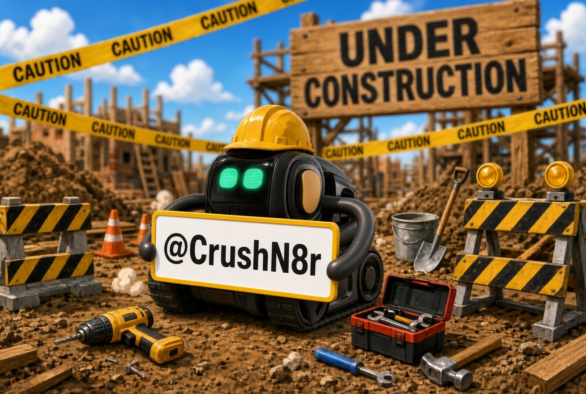
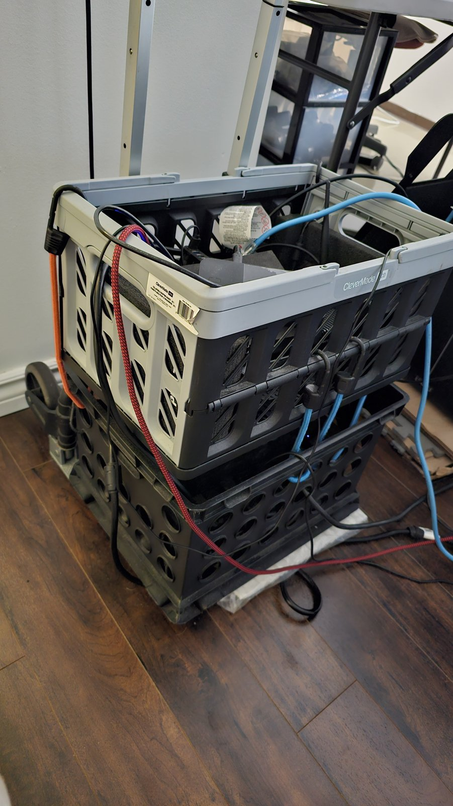
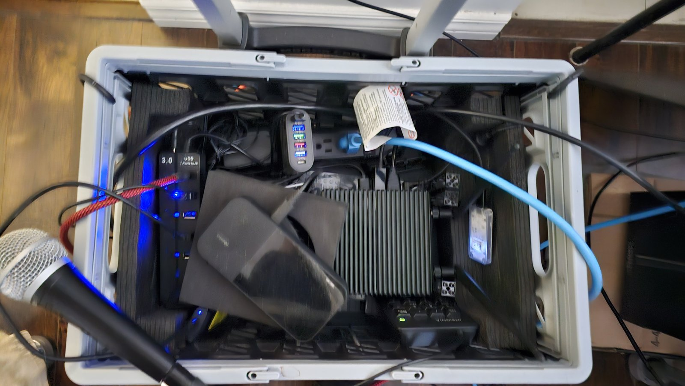

# GOPOD

Now that you're here, you can GOPOD Yourself! Lol

> **AI Wordplay! Explain the MAth!**
>
> Talking to an AI is a challenge and a response. So is a comedy room, a classroom, a contest, a
> pitch - pretty much everything going on in the world right now. GOPOD turns that loop into a show.

Two rescued Vector robots, Brobot 1 and Brobot 2, running on Wire-Pod and talking out loud
with a local AI. No cloud.

Wire-Pod is the open-source local server that keeps Anki Vector robots running without the
original cloud. GOPOD runs two of them, Brobot 1 and Brobot 2, on one Jetson: one shared
conversation, scripted performances, and upstream Wire-Pod left untouched through an overlay
build.

**Watch:** [VIDEO PLACEHOLDER — `start bingo test` run]

## I want this!

- **Two real robots, live, with a room.** Not a video, not an avatar: two Vectors holding one
  conversation with whoever's in front of them - and roasting each other while they're at it.
- **The crowd joins from their phones.** Join the rig's Wi-Fi, open the chat, get a username, talk
  to the Brobots from your seat.
- **No internet, no monthly bill.** The brain, the voices and the ears all run on the rig. A
  basement, a park, a moving van: it works.
- **A show you can script.** Generate it, keep the best takes, replay it the same way every time -
  ready to record.
- **A whole cast on a numpad.** Reporters, a news crew, security guards, students, a social media
  manager: each a voice, each a key.
- **Change anything without code.** One menu on the chat page: every setting, song, voice and test.
- **Free and open.** MIT licensed, built on Wire-Pod, and Wire-Pod itself stays untouched.

**[Get it: GOPOD_YOURSELF.md](GOPOD_YOURSELF.md)**

## What GOPOD really is

**A platform, not a game.** It started as a demo of a demo of a demo. That led to one question:
*how do I show everyone everything about GOPOD?* The answer was a game - a 20-Questions-style
engine where the room asks, the Brobots answer one point at a time, and every answer scores. That
grew into one templated GOPOD engine: chapters, topics, songs and personas, all built from the same
templates. What's left is minor bugs and a few template adjustments.

The game in this repo is the test bench: it's how live and scripted Brobot chat gets engaged and
tested. It isn't *the* game to play. It's an example of how a game and chat platform got made -
for the community to take further.

## Build it with me

I can't do it all alone - it's too expensive and too time-consuming for one person. That's where
the Wire-Pod community comes in. Open lanes, ready for you:

| Build | Start from |
|---|---|
| **Your own game** - your chapters, your topics, your scoring | the topic template, [`gopod_probes/_topic_cluster/`](goverlord/wire_pod_overlay/chipper/gopod_probes/_topic_cluster/README.md) |
| **Your own songs and scripted shows** | `goverlord/runtime/songs/_new_song/`, and [ALIAS-PLAY-STUDIO.md](ALIAS-PLAY-STUDIO.md) |
| **Your own cast** - new personas, new voices | [`gopod_probes/personas/`](goverlord/wire_pod_overlay/chipper/gopod_probes/personas/README.md) |
| **Bodies for the voice-only cast** - the Cozmo students, the Moorebot Scout guards | not wired yet: wide open |
| **More robots on stage** - GOPOD casts two Vectors today | [GOPOD_YOURSELF.md, how many robots](GOPOD_YOURSELF.md#how-many-robots) |
| **Other machines** - a PC, a Pi, a TV box | not tested yet: tell us what works |
| **Bugs and template tweaks** | the list in [WIRED-POD.md, "Where this stands"](WIRED-POD.md#6-where-this-stands) |

Made something? Fork it, send a pull request, or tell me about it: contact@crushn8r.ca.

## Where it leads

GOPOD is the build behind a lot of doors. These are the ones I'm chasing - the same build works
for yours:

- **Local gigs** - birthdays and BBQs to start, paid and volunteer: [BOOKING.md](BOOKING.md).
- **The livestream and its contest** - "AI Wordplay! Explain the MAth!", the benchmark to reach for:
  [LIVESTREAM.md](LIVESTREAM.md).
- **The niche pillar sites** - foodmath, accessmath, mathaftermath and more, each a pillar waiting
  to be grown, Pinterest first: [where it lands](LIVESTREAM.md#where-it-lands).

## Want one? Start here

**[GOPOD_YOURSELF.md](GOPOD_YOURSELF.md)** - the whole set-up, start to finish, with a check after
every step. Written so you can hand it to your AI helper too. One Vector, two, or a whole shelf of
them.

Pick your lane:

- **PERFORM** - how GOPOD is put together as a mobile performance station: a rig that rolls into a
  room, runs offline, and lets the crowd join the chat from their phones. Made for paying gigs
  and for making content on the move.
- **COMPOSE** - how GOPOD is played, with the Alias Play Studio: songs, scripted runs, a cast of
  voices, and a menu to change it all without code.

Both lanes lead out to the websites, the socials and the contest - and to what *you* make with it.

## How to play, not what to play

GOPOD's game isn't *what* to play. It's *how* to play - that's the teaching tool: "This is how I
thought it through. So you can too." Teach not what to think, but how to think: how to approach,
how to engage, how to interact, how to gracefully exit.

> Be a good surfer on the ocean waves of life and you'll do fine. Explain the Math!

That's why it's a treasure hunt: GOPOD has value worth chasing. The chase - learning from all of
it - is the gift back.

## What it does

- **Two Brobots, one conversation.** Ask either Vector. They share one chat, remember it, and
  each knows which brother he is.
- **A local brain.** Ollama with `gemma2:2b` on a Jetson, loaded at start and kept warm. No
  cloud, no monthly bill.
- **A chat window on Wire-Pod's own page.** Each line lights up as it's spoken. Type a line,
  or hold a numpad key and talk.
- **Named runs.** `start interview` plays a scripted interview, the same every
  time and ready to record. `start bingo test` plays the Bingo test song. `start baby
  brobots` plays a lyric video in the chat while the Brobots act it out. `start fart joke`
  plays the fart joke. `stop run` stops any of them at a safe spot.
- **GOPOD Yourself.** Say the wake phrase: Brobot 1 points you to the newsletter, Brobot 2 to
  crushn8r.ca.
- **Generate, then script.** The local LLM writes the interview, you keep the best takes,
  and the result is a plain script you can edit and replay.
- **Native Wire-Pod stays stock.** GOPOD changes nine Wire-Pod files through Go's overlay
  build and keeps everything else in its own folder.

## What's new

- **System menu.** Click the speaker icon on the chat page: every setting, song, voice and
  test, grouped in order, answered in the same window. Edit GOPOD without a terminal.
- **Camera feeds.** Each Brobot's camera in the chat, with the Edge TPU's object boxes.
  KP+ / KP- switch feeds.
- **The app: the crowd joins in.** At a live gig, people join the rig's Wi-Fi and open the chat
  on their phone as an app. They ask for a username, you approve it, and they talk to the Brobots
  under their own name - the same bubbles and highlight, nothing of Wire-Pod's own pages. Its
  home: [accessmath.crushn8r.net](ACCESSMATH.md).
- **A cast on the numpad.** KP1/KP2 talk to the Brobots, KP0 to both. KP7 CHALK and KP8
  PLAYHEAD (the news crew), KP3/KP4 the Cozmo students Git Repo and Cache PYC, KP5/KP6 the
  Moorebot Scout security guards Intel 404 PNFH and PNFT, KP9 Cameo (social media): each a
  voice persona with its own Kokoro voice (the guards one voice, pitched apart with sox),
  answering from the local LLM. Pick each key's voice from a menu (`system-voices`).
- **Before and after a song.** Ask about Bingo or dreams before the song has played and the
  Brobots tease it; after, they remember it their own way, and one of them tells the viewers
  how to start it. One template for every song (`experiences` in the settings file).
- **Voice files that look after themselves.** Each voice file carries a profile: made when,
  played how often, last played. `system-voices-report week` shows what's popular.
- **Your files stay yours.** Wire-Pod runs as root; everything GOPOD makes in your home (voices,
  photos, sessions) is still owned by you.

## Take it home

Start with [GOPOD_YOURSELF.md](GOPOD_YOURSELF.md): the set-up in order, one check per step, and
one script (`goverlord/gopod_paths.sh`) that points GOPOD's files at your machine.

[WIRED-POD.md](WIRED-POD.md) is the Take Out: a thank-you back to the Wire-Pod community in
three parts. Part 1 is the alias play studio, part 2 the chat page, part 3 the offline LLM.
Each part lists what you need, what to copy, what to change, and how to know it works. How songs are built, note by
note, is in [ALIAS-PLAY-STUDIO.md](ALIAS-PLAY-STUDIO.md).

**GOPOD not tested on other devices or set ups. Back up your stuff and attempt at your own risk.**

### With one Vector, or five

Most Wire-Pod owners have one robot, and GOPOD works with one. At start, the Brobots are the robots
Wire-Pod knows; one robot alone is Brobot 1, solo:

- **The chat:** a line to All - typed, the menu, or numpad 0 - goes to him alone, and Brobot 2's key goes to him.
- **The persona:** the shared Brobots persona stays; his prompt drops his brother and says he's on his own today.
- **Scripted runs:** Brobot 2's lines are said on the computer's speaker.

To pick which robot is which, set `brobots_setup.brobot_1` / `brobot_2` (an ESN) in the settings file.

**Three or more Vectors:** pick two to be the Brobots, the same way. The rest stay ordinary Wire-Pod
Vectors - working as always, just not in the cast, the shared chat or the songs. Swap who's on stage
by changing the pick and restarting. Not live-tested with more than two connected.

GOPOD names the robots by label everywhere public - ESN01 is Brobot 1's robot, ESN02 Brobot 2's.
Your own robots' serials go in a private file in your home, `~/.gopod_esns.json`
(`{"ESN01": "<serial>", "ESN02": "<serial>"}`), never in the repo; Wire-Pod changes a label to its
robot as a call comes in.

## The rig

Two crates on one dolly. Roll in, plug in, party.

| Part | What it does |
|---|---|
| 2 × Anki Vector | Brobot 1 and Brobot 2. |
| NVIDIA Jetson Orin NX 16GB (Ubuntu) | Runs Wire-Pod, Ollama, the voices and the chat page. |
| Anker Solix C1000 | Portable power station (the bottom crate). |
| Inseego MiFi M3000 hotspot | Local Wi-Fi linking the two robots and the Jetson. |
| XLR mic and an XLR-to-USB cable | The room mic: numpad push-to-talk and Record Session. |
| USB numpad, USB 3.0 hub, power bar, fan | Push-to-talk keys, ports, power, cooling. |
| Coral USB Edge TPU | The object boxes on the Brobots' camera feeds. |

The crates, power and networking modes, with more photos: [MOBILE_GEAR.md](MOBILE_GEAR.md).

About $1K to $3K CDN.

## Privacy and safety

- **Local first.** The LLM, speech-to-text and the voices all run on the Jetson. Only the
  live weather goes online (Wire-Pod's own weather key); offline, the Brobots say so.
- **Nothing private in this repo.** No API keys, robot tokens or certificates, and no
  conversation logs or recordings. Those stay on the machine.
- **A clean act.** The room is adult, the material isn't: no drinking, no swearing, and
  gambling never comes up.

## Where it stands

Live-tested: the Brobots chat, the scripted interview, the Bingo test song, numpad
push-to-talk, the numpad's voice personas. Not yet, and said plainly: see "Where this stands" in
[WIRED-POD.md](WIRED-POD.md#6-where-this-stands). The websites are under construction; some
work well enough to demo.

## More

### GOPOD edutainment - GOPOD's own content

The game, the songs, the chat and the Brobots: what GOPOD plays and teaches, in the room.

- [ACCESSMATH.md](ACCESSMATH.md): GOPOD for everyone - the app, access built in, a healthy
  distraction, and where GOPOD teaches.
- [BROBOT_ASKS.md](BROBOT_ASKS.md): what to ask the Brobots - each topic's ask, what you get,
  and where to read more.
- [BOOKING.md](BOOKING.md): gigs to book - the rooms, birthdays, BBQs, videos, printables and
  affiliates, live or scripted.

### The content engine - the livestream first, plus the Pinterest niche pillars

What GOPOD's sessions turn into outside the room: the contest, its clips, and the pages they lead to.

- [LIVESTREAM.md](LIVESTREAM.md): the livestream - AI Wordplay! Explain the MAth!, the contest
  and its nine themes, where it lands, and the channel.
- [SOCIAL_MEDIA.md](SOCIAL_MEDIA.md): the socials, the niche pillars, and help wanted.

### The build

- [GOPOD_TORAH.md](GOPOD_TORAH.md): the GOPOD Torah (each scripture its own scroll in [torah/](torah/)) - the master reference for the system window
  (every group, command, test and run), written by GOPOD itself so it always matches.
- [MOBILE_GEAR.md](MOBILE_GEAR.md): the rig on its dolly - what's in each crate, the
  networking and power modes, and the photos.
- [GOPOD_YOURSELF.md](GOPOD_YOURSELF.md): set it up yourself, start to finish - and the prompt to
  hand your AI helper.
- [WIRED-POD.md](WIRED-POD.md): what GOPOD adds on top of Wire-Pod, and how to take it home.
- [ALIAS-PLAY-STUDIO.md](ALIAS-PLAY-STUDIO.md): GOPOD's own documentation - songs, the chat page,
  every rule and command.

**Contact:** [crushn8r.ca](https://crushn8r.ca), and the CRUSHN8R CREW'd newsletter.

## Credits

Built on [Wire-Pod](https://github.com/kercre123/wire-pod) by kercre123 and its contributors,
the community that kept Vector alive. MIT license, see [LICENSE](LICENSE). Third-party
licenses: [THIRD_PARTY_LICENSES.md](THIRD_PARTY_LICENSES.md).
