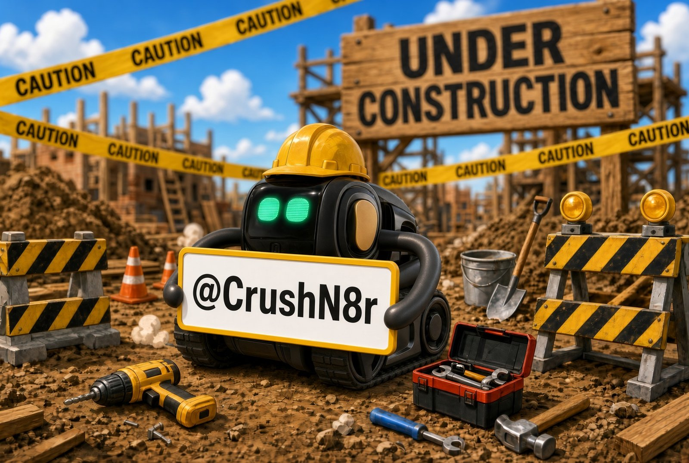
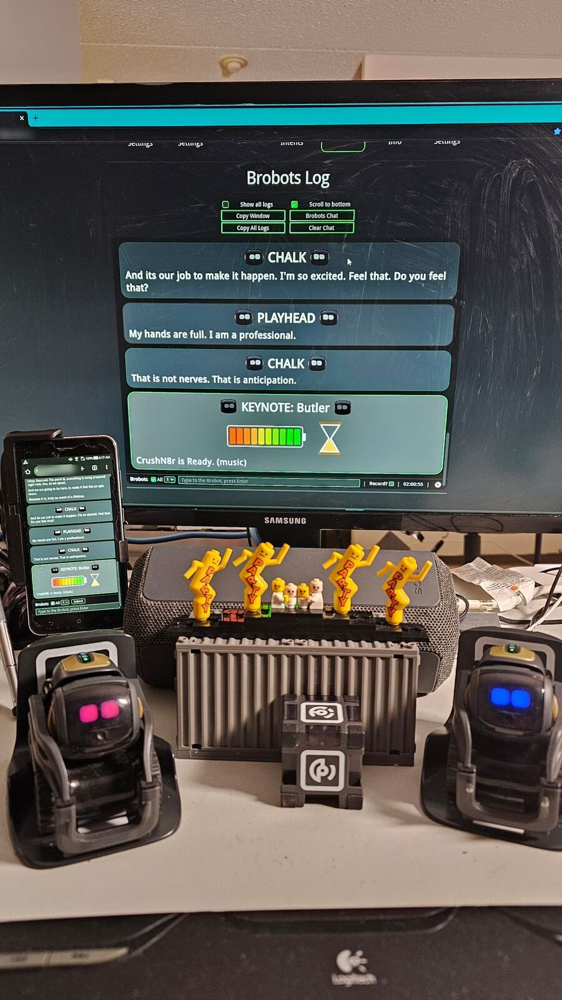
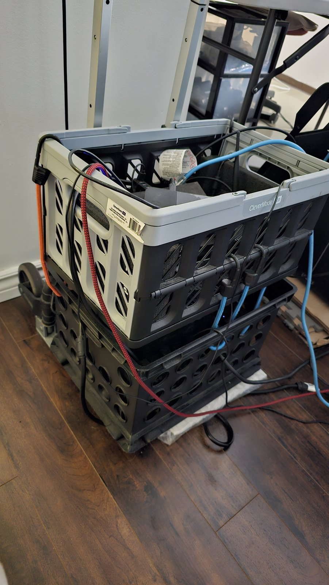
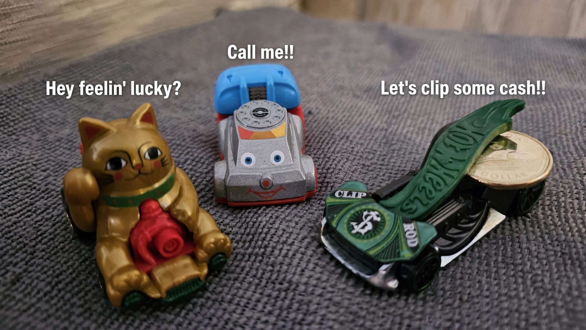

# GOPOD

Now that you're here, you can GOPOD Yourself! Lol

> **AI Wordplay! Explain the MAth!**
>
> Talking to an AI is a challenge and a response. So is a comedy room, a classroom, a contest, a
> pitch - pretty much everything going on in the world right now. GOPOD turns that loop into a show.

**Two rescued Vector robots, Brobot 1 and Brobot 2, talking out loud with a local AI. No cloud.**

<em>LLM Ready. The chat on the big screen, the same chat in the app on a phone - and the Brobots, waiting for you.</em>

## Pick your door

| | |
|---|---|
| **Watch it** | The livestream and its contest, *AI Wordplay! Explain the MAth!* - and the clips. [LIVESTREAM.md](LIVESTREAM.md) · [SOCIAL_MEDIA.md](SOCIAL_MEDIA.md) |
| **Book it** | Two real robots at your bingo night, birthday, classroom, bar or BBQ - live or scripted. [BOOKING.md](BOOKING.md) |
| **Build it** | Your own Brobots on your own Wire-Pod - one Vector or a whole shelf of them. [GOPOD_YOURSELF.md](GOPOD_YOURSELF.md) |

## I want this!

- **Two real robots, live, with a room.** Not a video, not an avatar: two Vectors holding one
  conversation with whoever's in front of them - and roasting each other while they're at it.
- **The crowd joins the chat from their phones.** Join the rig's Wi-Fi, open the chat, get a username, talk
  to the Brobots from your seat.
- **Works offline, without Internet.** The brain, the voices and the ears all run on the rig. A
  basement, a park, a moving van: it works.
- **Script your own performances.** Generate them, keep the best takes, replay them the same way every time -
  ready to record.
- **Create a cast. Group chat via a keyboard numpad.** A butler, a news crew, interns, security guards, a social media
  manager: each a voice, each a key.
- **Change settings in the GOPOD system window.** One menu on the chat page: every setting, song, voice and test.
- **Free and open.** MIT licensed, built on Wire-Pod, and Wire-Pod itself stays untouched.

## Meet the cast

Two robot bodies, four Brobot personas, and a whole crew of voices - every one on a numpad key.

<!-- gopod cast table: written by GOPOD from the numpad map (numpad-mapper.md) - system-scrolls writes it again -->
| Key | Who | What they do |
|---|---|---|
| KP0 | **KEYS** - KEYNOTE VALE | Butler, Goverlord's voice |
| KP1 | **DOC** - DOCTRINE BARFALLONYOU SPEWER, on Brobot 1 | the host - explains too hard, on purpose |
| KP2 | **PIP** - PIP N STALL, on Brobot 2 | the sidekick - the room's pied piper |
| KP3 | **REPO** - Git Repo | Tech Intern - the USB ports & getting weather info |
| KP4 | **MIMI** - Cache PYC | Display and Social Media Intern - the weather, ready to say |
| KP5 | **BUZZER** - Intel 404 PNFH | Brobot 1's battery |
| KP6 | **SWITCH** - Intel 404 PNFT | Brobot 2's battery |
| KP7 | **CHALKRA** - CHALK BORED | Display Gomad, the display and the board |
| KP8 | **ZOOMY** - PLAYHEAD ZUMINTU | Session Gomad, the runs and the session |
| KP9 | **CHAMMY** - CAMEO LOOKS | Content Gomad, social media |
| KP0, NumLock off | **Goverlord** - GOPOD's brain | GOPOD's brain |
| KP1, NumLock off | **BRUH-1** - Brobot 1 | grumpy, impatient |
| KP2, NumLock off | **BRUH-2** - Brobot 2 | clueless, happy |
| KP3, NumLock off | **LLM** - ELLE-ELLE EHM GEMMA | the LLM Gomad - maximum wordplay fun |
| KP7, NumLock off | **CHALKRA** - CHALK BORED, on location | Display Gomad, the display and the board |
| KP8, NumLock off | **ZOOMY** - PLAYHEAD ZUMINTU, on location | Session Gomad, the runs and the session |
| * | **All the Brobots** | One line, both answer. |
<!-- /gopod cast table -->

Game card: the rest of the cast

<!-- gopod topic: 03_future_cast -->

# the rest of the cast
- **chapter:** Show and tell

- **words:** other robots, more robots, cozmo, cozmos, reporter, reporters, chalk, playhead, git repo, cache pyc, pnfh, pnft, intel 404, who else is here, who else is coming, six robots, the cast, moorebot, scout, scouts, intern, interns
- **pictures:** gear/crate_2_display.jpg
- **reminder:** Hey, that reminds me... There's a whole cast on the numpad.
- **notes 1:** CHALK and PLAYHEAD | the news crew | KP7 and KP8 | live
- **notes 2:** the interns | Git Repo and Cache PYC | KP3 and KP4 | voices now, Cozmo bodies coming
- **notes 3:** the security guards | Intel 404 PNFH and PNFT | KP5 and KP6 | voices now, Moorebot Scout bodies coming
- **summary:** CHALK and PLAYHEAD: the news crew, live | the interns Git Repo and Cache PYC: voices now, bodies coming | the guards Intel 404 PNFH and PNFT: voices now, bodies coming
- **source:** README.md

---

The rest of the cast - each one a voice in the chat, on a numpad key. Reveal these, in order, in your own words:
1. CHALK BORED and PLAYHEAD ZUMINTU, the news crew - CHALK runs the display on KP7, PLAYHEAD runs the session on KP8 - Gomads indoors, and reporters on location.
2. The interns: Git Repo, the tech intern, and Cache PYC, the display and social media intern - KP3 and KP4. Their voices are live now; their Cozmo robot bodies are coming.
3. The security guards: Intel 404 PNFH and Intel 404 PNFT, watching the Brobots' batteries - KP5 and KP6. Voices live now, Moorebot Scout bodies coming. And Cameo, the social media Gomad, is on KP9.

## What GOPOD really is

**A platform, with an example game engine.** It started as a demo of a demo of a demo. That led to one question:
*how do I show everyone everything about GOPOD?* The answer was a game - a 20-Questions-style
engine where the room asks, the Brobots answer one point at a time, and every answer scores. That
grew into one templated GOPOD engine: chapters, topics, songs and personas, all built from the same
templates.

The game in this repo is the test bench: it's how live and scripted Brobot chat gets engaged and
tested. It isn't *the* game to play. It's an example of how a game and chat platform got made -
for the community to take further.

## How to play, not what to play

GOPOD's game isn't *what* to play. It's *how* to play - that's the teaching tool: "This is how I
thought it through. So you can too." Teach not what to think, but how to think: how to approach,
how to engage, how to interact, how to gracefully exit.

> Be a good surfer on the ocean waves of life and you'll do fine. Explain the Math!

That's why it's a treasure hunt: GOPOD has value worth chasing. The chase - learning from all of
it - is the gift back.

## Try these

- Ask either Brobot anything. They share one chat, remember it, and each knows which brother he is.
- `start bingo test` - the Bingo test song.
- `start baby brobots` - a lyric video in the chat while the Brobots act it out.
- `start fart joke` - the fart joke.
- `stop run` - stops any of them at a safe spot.
- Say the wake phrase, **GOPOD Yourself**: Brobot 1 points you to the newsletter, Brobot 2 to crushn8r.ca.

What to ask, topic by topic: [BROBOT_ASKS.md](BROBOT_ASKS.md).

## The rig

Two crates on one dolly. Roll in, plug in, party.

| Part | What it does |
|---|---|
| 2 × Anki Vector | Brobot 1 and Brobot 2. |
| NVIDIA Jetson Orin NX 16GB (Ubuntu) | Runs Wire-Pod, the local AI, the voices and the chat page. |
| Anker Solix C1000 | Portable power station (the bottom crate). |
| Inseego MiFi M3000 hotspot | Local Wi-Fi linking the two robots and the Jetson. |
| XLR mic and an XLR-to-USB cable | The room mic: numpad push-to-talk and Record Session. |
| USB numpad, USB 3.0 hub, power bar, fan | Push-to-talk keys, ports, power, cooling. |
| Coral USB Edge TPU | The object boxes on the Brobots' camera feeds. |

About $3K USD when this rig was built; up to about $5.5K USD at today's prices. Owning the Vectors,
a laptop or a power station already brings it down. The crates, power and networking, with more
photos: [MOBILE_GEAR.md](MOBILE_GEAR.md).

## Build it with me

I can't do it all alone - it's too expensive and too time-consuming for one person. That's where
the Wire-Pod community comes in. Open lanes, ready for you:

| Build | Start from |
|---|---|
| **Your own game** - your chapters, your topics, your scoring | the topic template, [`gopod_probes/topic_clusters/_topic_cluster/`](goverlord/wire_pod_overlay/chipper/gopod_probes/topic_clusters/_topic_cluster/README.md) |
| **Your own songs and scripted shows** | `goverlord/runtime/songs/_new_song/`, and [ALIAS-PLAY-STUDIO.md](ALIAS-PLAY-STUDIO.md) |
| **Your own cast** - new personas, new voices | [`gopod_probes/topic_clusters/content/personas/`](goverlord/wire_pod_overlay/chipper/gopod_probes/topic_clusters/content/personas/README.md) |
| **Bodies for the voice-only cast** - the Cozmo interns, the Moorebot Scout guards | not wired yet: wide open |
| **More robots on stage** - GOPOD casts two Vectors today | [GOPOD_YOURSELF.md, how many robots](GOPOD_YOURSELF.md#how-many-robots) |
| **Other machines** - a PC, a Pi, a TV box | not tested yet: tell us what works |
| **Bugs and template tweaks** | the list in [WIRED-POD.md, "Where this stands"](WIRED-POD.md#6-where-this-stands) |

Made something? Fork it, send a pull request, or tell me about it: contact@crushn8r.ca.

**One Vector works too.** Most Wire-Pod owners have one robot: he's Brobot 1, solo, and the show
adapts. Three or more? Pick two to be the Brobots; the rest stay ordinary Wire-Pod Vectors.
How: [GOPOD_YOURSELF.md](GOPOD_YOURSELF.md#how-many-robots).

## Where it leads

GOPOD is the build behind a lot of doors. These are the ones I'm chasing - the same build works
for yours:

- **Local gigs** - birthdays and BBQs to start, paid and volunteer: [BOOKING.md](BOOKING.md).
- **The livestream and its contest** - "AI Wordplay! Explain the MAth!", the benchmark to reach for:
  [LIVESTREAM.md](LIVESTREAM.md).
- **The niche pillar sites** - foodmath, accessmath, mathaftermath and more, each a pillar waiting
  to be grown, Pinterest first: [where it lands](LIVESTREAM.md#where-it-lands).
- **GOPOD for everyone** - the app, access built in, a healthy distraction: [ACCESSMATH.md](ACCESSMATH.md).

## Privacy and safety

- **Local first.** The AI, speech-to-text and the voices all run on the Jetson. Only the live
  weather goes online; offline, the Brobots say so.
- **Nothing private in this repo.** No API keys, robot tokens or certificates, and no
  conversation logs or recordings. Those stay on the machine.
- **A clean act.** The room is adult, the material isn't: no drinking, no swearing, and
  gambling never comes up.

## Where it stands

Live-tested: the Brobots chat, the scripted runs, the Bingo test song, numpad push-to-talk and the
whole numpad cast. Not yet, said plainly: "Where this stands" in
[WIRED-POD.md](WIRED-POD.md#6-where-this-stands). The websites are under construction; some work
well enough to demo.

**GOPOD isn't tested on other devices or set-ups. Back up your stuff and try it at your own risk.**

## For builders

- [GOPOD_YOURSELF.md](GOPOD_YOURSELF.md) - the whole set-up, start to finish, one check per step.
  Written so you can hand it to your AI helper too.
- [WIRED-POD.md](WIRED-POD.md) - the Take Out: what GOPOD adds on top of Wire-Pod, in three parts
  (the alias play studio, the chat page, the offline AI), and how to take it home.
- [ALIAS-PLAY-STUDIO.md](ALIAS-PLAY-STUDIO.md) - how songs are built, note by note, and every rule.
- [GOPOD_SYSTEM_SCROLLS.md](GOPOD_SYSTEM_SCROLLS.md) - the master reference for the system window, written by GOPOD
  itself so it always matches.

**Contact:** [crushn8r.ca](https://crushn8r.ca), and the CRUSHN8R CREW'd newsletter.

## Credits

Built on [Wire-Pod](https://github.com/kercre123/wire-pod) by kercre123 and its contributors,
the community that kept Vector alive. MIT license, see [LICENSE](LICENSE). Third-party
licenses: [THIRD_PARTY_LICENSES.md](THIRD_PARTY_LICENSES.md).
